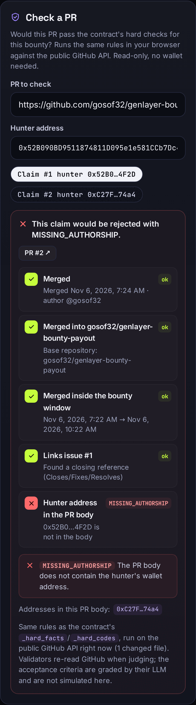
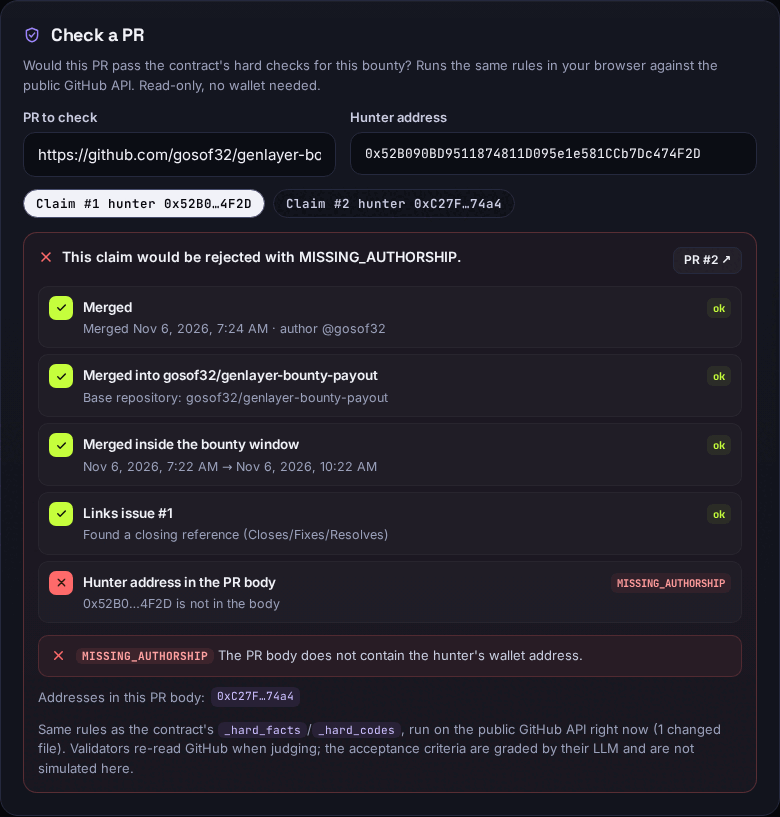
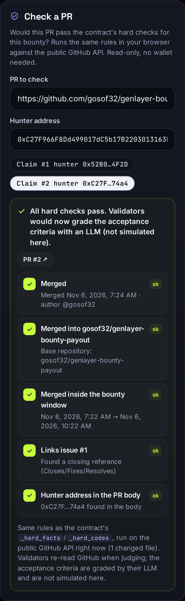
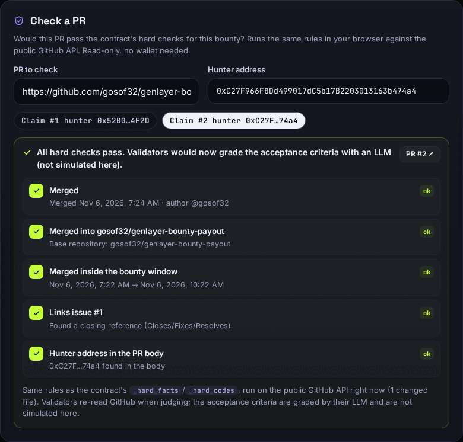
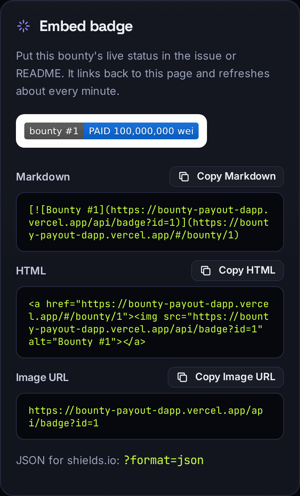
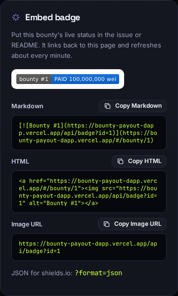

# Bounty Payout dApp

**A web app for escrowed GitHub issue bounties that pay themselves out through GenLayer validator consensus.**

Contract on GenLayer Studionet: [`0xFb2372a7325F63Bb4f0a3330C075e9F58Fe7466A`](https://explorer-studio.genlayer.com/address/0xFb2372a7325F63Bb4f0a3330C075e9F58Fe7466A)
Contract primitive (standalone repo, 88 contract tests, full lifecycle record): https://github.com/gosof32/genlayer-bounty-payout
Live app: https://bounty-payout-dapp.vercel.app/

[](https://bounty-payout-dapp.vercel.app/#/bounty/1)
[](https://bounty-payout-dapp.vercel.app/#/bounty/2)
[](https://bounty-payout-dapp.vercel.app/#/bounty/3)

---

## Milestone 1: what changed and why

Delta from the accepted version [`1d7df27`](https://github.com/gosof32/bounty-payout-dapp/commit/1d7df27). **The contract is unchanged** (same file, same deployment `0xFb23…466A`); everything below is frontend, a read-only serverless function, and tests.

| Change | Why it matters |
|---|---|
| **Claim preflight.** When a hunter enters a PR in the claim form, the app reads it from the public GitHub REST API and runs a JS port of the contract's own hard checks (`_parse_pr_ref`, `_links_issue`, `_has_address`, `_parse_ts`/`_iso`, `_hard_facts`, `_hard_codes`, and the `NOT_READY`/`INCONCLUSIVE` branches of `_judge_once`). It shows a pass/fail checklist and "this claim would be rejected with X" **before signing**, and still lets the hunter sign. | A failed judgement burns one of the claim's limited attempts and a transaction. Most rejections are mechanical (no address in the PR body, issue not linked, merged outside the window); the hunter now sees them for free, before spending anything. |
| **"Check a PR" tool** on every bounty page, read-only, no wallet. Pick a claimant's address (or type any) and check any PR of the bounty repo. | Sponsors, reviewers and hunters can audit a claim or a judgement without a wallet. On bounty #1 it reproduces the on-chain history exactly: PR #2 + outsider → `MISSING_AUTHORSHIP`, PR #2 + hunter → all hard checks pass (accepted on-chain). `npm run preflight:live` re-checks every on-chain claim this way. |
| **Parity tests, Python vs JS.** 186 fixture cases in [`tests/parity/cases.json`](tests/parity/cases.json) (including the real PR #2 payload) are run through the **contract module itself** (pytest, direct mode) and through `src/lib/preflight.js` (vitest) against the same recorded outputs. | The preflight can't silently drift from the contract. Edge cases covered: Unicode `\w`/`\d`/`\s` semantics in the regexes, `str.strip()`/`isdigit()`, CPython's `fromisoformat` quirks, malformed payloads, every rejection code. |
| **Bounty badge** `GET /api/badge?id=N` (Vercel Function): reads `get_bounty` with a read-only genlayer-js client and returns a shields-style SVG (`bounty #1 \| PAID 100,000,000 wei`), colour per status, `Cache-Control: s-maxage=60`, an error badge for unknown ids, and `?format=json` in the shields.io endpoint schema. **Embed badge** panel on the bounty page with copyable Markdown/HTML. | Bounties live where contributors already are: the issue, the README, a tweet. The badge shows live on-chain status and links back to the bounty page, which is the adoption loop. |
| Vite build split into vendor chunks (no chunk-size warning). | Clean `vite build`, better caching. |

Screenshots (real data: Studionet contract + GitHub API, PR #2 against bounty #1):

| 390 px | 1280 px |
|---|---|
|  |  |
|  |  |
|  |  |

Full pages: [`bounty-detail-390.png`](docs/screenshots/bounty-detail-390.png), [`bounty-detail-1280.png`](docs/screenshots/bounty-detail-1280.png) (no horizontal overflow at either width).

### Claim preflight

What it checks, in the contract's order and with the contract's codes (plain-English texts are the same `CODE_TEXT` the claim cards use):

| Check | Code when it fails |
|---|---|
| PR merged | `NOT_MERGED` (an open PR → judging returns `NOT_READY`, no attempt used) |
| Base repository is the bounty repo (case-insensitive) | `WRONG_REPO` |
| `merged_at` inside `created_at … deadline` of the bounty | `MERGED_BEFORE_BOUNTY` / `MERGED_AFTER_DEADLINE` |
| Title or body references the issue (`#N`, `owner/repo#N` or the issue URL) | `ISSUE_NOT_LINKED` |
| PR body contains the hunter's address (not as part of a longer hex string) | `MISSING_AUTHORSHIP` |

- Same URLs as the validators: `GET https://api.github.com/repos/{repo}/pulls/{n}` and `/files?per_page=100`, unauthenticated. Results are cached for 60 s per PR.
- GitHub's unauthenticated limit is 60 requests/hour per IP. A `403`/`429` rate-limit answer shows a notice with the reset time and **does not block** the claim; validators read GitHub themselves.
- A PR number GitHub doesn't know → "validators would return INCONCLUSIVE". A PR URL in another repo → the contract's own `[INVALID]` message, without calling GitHub.
- The acceptance criteria are graded by the validators' LLM and are **not** simulated; the preflight covers the deterministic part only. The PR can change between the check and the judgement.

Code: [`src/lib/preflight.js`](src/lib/preflight.js), [`src/components/PrCheck.jsx`](src/components/PrCheck.jsx). Parity: [`tests/direct/test_parity.py`](tests/direct/test_parity.py), [`tests/frontend/parity.test.js`](tests/frontend/parity.test.js), cases built by [`tests/parity/build_cases.py`](tests/parity/build_cases.py) (`REGEN_PARITY=1 pytest tests/direct/test_parity.py` re-records them from the contract).

### Bounty badge

```
GET /api/badge?id=1                  → image/svg+xml   "bounty #1 | PAID 100,000,000 wei"
GET /api/badge?id=1&format=json      → {"schemaVersion":1,"label":"bounty #1","message":"PAID 100,000,000 wei","color":"#0969da"}
GET /api/badge?id=99                 → error badge "bounty #99 | not found" (header X-Badge-Error: not found)
GET /api/badge?id=1&contract=0x…     → same, for another deployment of this contract
```

| Status | Colour |
|---|---|
| `OPEN` | green `#2ea043` |
| `PAID` | blue `#0969da` |
| `CANCELLED` | grey `#8b949e` |
| `REFUNDED` | amber `#bf8700` |
| error (`not found`, `invalid id`, `unavailable`) | red `#cf222e` |

- `Cache-Control: public, max-age=60, s-maxage=60, stale-while-revalidate=300` (errors: 30 s). Error badges are served with HTTP 200 so they still render through GitHub's image proxy and shields.io.
- Read-only: `get_stats` (to answer unknown ids without an RPC error) and `get_bounty`. No account, no key.
- Embed (also on every bounty page under **Embed badge**):

```markdown
[](https://bounty-payout-dapp.vercel.app/#/bounty/1)
```

```html
<a href="https://bounty-payout-dapp.vercel.app/#/bounty/1"></a>
```

Outputs of the handler run locally against live Studionet: [`docs/badges/`](docs/badges) (`bounty-1.svg` … `bounty-99.json`), produced by `npm run badge:local`.

Code: [`api/badge.js`](api/badge.js) (Vercel picks up files in the root `api/` directory as Functions with any framework preset, including Vite; it uses the Web-standard `GET(request)` export), [`src/lib/badge.js`](src/lib/badge.js) (SVG/JSON generator shared with the in-app preview), [`src/components/EmbedBadge.jsx`](src/components/EmbedBadge.jsx).

## What it is

Open-source bounties have a trust problem at the end: the sponsor decides whether the work counts, and the hunter has to trust they'll pay. Bounty Payout moves that decision into a GenLayer Intelligent Contract.

- A **sponsor** escrows GEN against one GitHub issue and 1-8 plain-text acceptance criteria.
- A **hunter** opens a PR that references the issue and carries their **wallet address in the PR body** (proof of authorship), then claims the bounty from that wallet.
- **Anyone** can ask the validators to judge the claim. Each validator reads the PR from the GitHub API. Contract code checks the hard facts (merged, right repo, inside the bounty window, issue linked, address present); only then does an LLM grade every criterion pass/fail with a reason. Validators must agree on every fact and every criterion.
- If everything passes, the reward is paid to the hunter **in the same transaction**. The sponsor can't veto it. No state leaves funds stuck: every bounty ends `PAID`, `CANCELLED` or `REFUNDED`.

This app is the frontend for that contract: browse bounties without a wallet, read exactly why a claim passed or failed, and post, claim, judge, cancel or refund from any EIP-1193 wallet.

## Features

- **Bounty list** with `OPEN` / `PAID` / `CANCELLED` / `REFUNDED` badges, status filters, reward, timeline phase (open, judging window, expired) and claim counts.
- **Bounty detail**: repo, issue link, criteria, reward, sponsor, created / deadline / judging-window times, links to the issue, the repo and the winning PR.
- **Claims** with status (`PENDING`, `ACCEPTED`, `REJECTED`, `SUPERSEDED`, `CLOSED`), hunter, PR link, PR author, merge time, merge commit link, evidence hash, rejection codes explained in plain English, and a **per-criterion pass/fail table with the validators' reasons**.
- **Post a bounty**: repo (or paste the issue URL to fill repo + issue), title, criteria one per line, reward sent as the call value, deadline, judging grace, claim and attempt limits. Inputs are validated with the contract's own rules before anything is signed.
- **Claim a bounty**: a helper that tells the hunter to put their wallet address in the PR body, with the exact lines (`Closes #N` + `Bounty payout address: 0x…`) and copy buttons. PR number or URL accepted, checked against the bounty repo. **Preflight** runs the contract's hard checks on the live PR before signing (see Milestone 1).
- **Check a PR** (read-only) and **Embed badge** on every bounty page.
- **Judge / Re-judge**: shown only when the contract would accept it (pending claim: anyone; rejected claim with attempts left: the hunter only; inside the judging window).
- **Cancel** (sponsor, no live claim) and **Refund** (anyone, after the deadline with no live claim, or after the judging window) shown only when the state machine allows them.
- **Transaction tracking**: *Sign in wallet → Submitted → Accepted by validators → Finalized*, explorer link, the judge verdict (ACCEPTED / REJECTED with codes / NOT_READY / INCONCLUSIVE) or the contract's revert reason. A transaction counts as done only when it is FINALIZED with validator agreement and a successful execution.
- **Read-only without a wallet.** Connecting adds and switches to GenLayer Studionet (chain 61999) with standard EIP-3085/3326 calls; "Get test GEN" funds the wallet on Studionet.
- Mobile-friendly layout, hash routing (`#/bounty/1`, `#/create`) so it works on any static host without rewrites.

## The live demo data

The reference contract holds three bounties, all run against the real GitHub API (details in [`deployments/studionet.json`](deployments/studionet.json)):

| Bounty | Status | What happened |
|---|---|---|
| #1 "Add a CONTRIBUTING guide" on [gosof32/genlayer-bounty-payout#1](https://github.com/gosof32/genlayer-bounty-payout/issues/1) | **PAID** | An outsider claimed [PR #2](https://github.com/gosof32/genlayer-bounty-payout/pull/2) → REJECTED `MISSING_AUTHORSHIP`, later SUPERSEDED. The real hunter claimed it → ACCEPTED, 3/3 criteria passed, paid in the same tx. |
| #2 "Refund demo" | **REFUNDED** | Nobody claimed; refunded to the sponsor after the deadline. |
| #3 "Cancel demo" | **CANCELLED** | Cancelled by the sponsor. |

Demo rewards are tiny amounts of test GEN, so the app shows them in wei.

## Run locally

```bash
npm install
npm run dev              # app at http://localhost:5173
npm test                 # 255 frontend tests (vitest + Testing Library), incl. 186 preflight parity cases
npm run build            # production build into dist/
npm run smoke:studionet  # read-only check against the live contract (no wallet, no writes)

pip install -r requirements-dev.txt
npm run test:contract    # 89 contract tests (GenLayer direct mode, mocked GitHub + LLM), incl. the parity check
npm run test:parity      # just the Python-vs-JS preflight parity (both sides)
npm run badge:local      # run /api/badge locally against live Studionet, writes docs/badges/
npm run preflight:live   # re-check every on-chain claim with the preflight on the real GitHub API
```

Point the app at your own deployment with `VITE_CONTRACT_ADDRESS` (see `.env.example`). Without it, the app uses the reference deployment above.

## Deploy to Vercel

1. In Vercel, **Add New → Project** and import `gosof32/bounty-payout-dapp`.
2. Framework preset: **Vite** (build command `npm run build`, output directory `dist`; both are detected automatically).
3. Optional: add the environment variable `VITE_CONTRACT_ADDRESS` to use a different contract.
4. Deploy. No rewrites or secrets are needed: the app talks to Studionet's public RPC from the browser and the user's wallet signs. The one server piece, `api/badge.js`, is deployed automatically as a Vercel Function (Node.js runtime) from the root `api/` directory.

The build uses relative asset paths (`base: "./"`), so `dist/` also works on GitHub Pages or any static host.

## Architecture

```
contracts/bounty_payout.py   the GenLayer Intelligent Contract (Python), same code as the deployed one
src/lib/bounty.js            reads, units, the bounty/claim state machine, input validation, result parsing
src/lib/wallet.js            wallet connect, Studionet switch, write → ACCEPTED → FINALIZED
src/lib/tx.js                receipt interpretation (status, consensus, execution, revert reason)
src/lib/preflight.js         JS port of the contract's hard-fact checks + GitHub fetch (claim preflight)
src/lib/badge.js             shields-style SVG / JSON badge generator
src/components/              BountyList, BountyDetail (claims, verdicts, claim form), PrCheck, EmbedBadge, CreateBounty, TxLog, CopyButton
api/badge.js                 Vercel Function: GET /api/badge?id=N (read-only contract read)
scripts/smoke-read.mjs       read-only smoke test against the live contract
scripts/badge-local.mjs      runs the badge handler locally against Studionet
tests/frontend/              vitest: state machine, parsing, validation, receipts, App flows, preflight, badge, parity
tests/direct/                contract tests (GenLayer direct mode), incl. test_parity.py
tests/parity/                shared Python/JS parity cases (+ the real PR #2 payload snapshot)
```

Contract API used by the app (from `contracts/bounty_payout.py`):

| Call | Kind | Used for |
|---|---|---|
| `get_stats()`, `list_bounties(offset, limit)` | view | bounty list (paged by 50) |
| `get_bounty(id)`, `get_claims(bounty_id)` | view | detail page |
| `create_bounty(repo, issue, title, criteria_json, deadline, judge_grace_hours, max_claims, max_attempts)` | payable write | post a bounty, reward = call value |
| `submit_claim(bounty_id, pr)` | write | claim with a PR number |
| `judge(claim_id)` | write | judge / re-judge via validator consensus |
| `cancel_bounty(bounty_id)`, `refund(bounty_id)` | write | return the reward to the sponsor |

The UI's action rules mirror the contract's guards exactly (see `bountyActions` / `claimActions` in `src/lib/bounty.js`), so a button only appears when the transaction can succeed; the contract still enforces every rule.

## Limits

- Public repositories only: validators read the unauthenticated GitHub API.
- The preflight is advisory: it covers the deterministic checks only (not the LLM grading) and reflects the PR at the moment you check it.
- Authorship is "the PR body carries your address". A maintainer who edits PR bodies could redirect a bounty, so post bounties on repos whose maintainers you trust.
- One reward per bounty, paid in full to the first accepted claim.
- Studionet test GEN has no value.

## License

MIT
